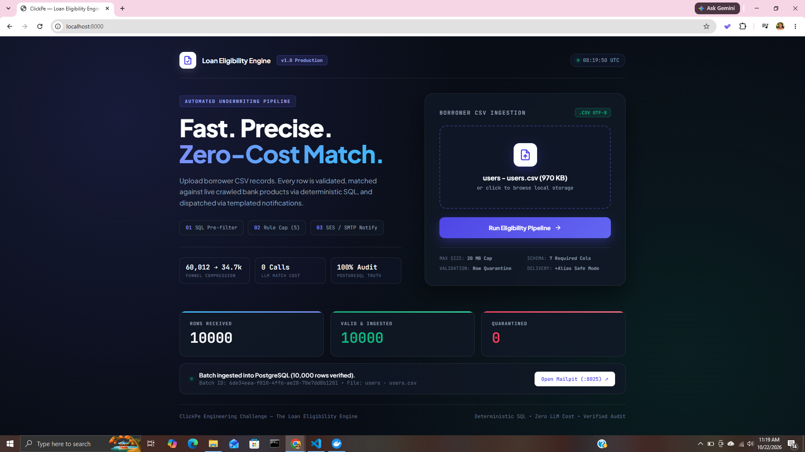
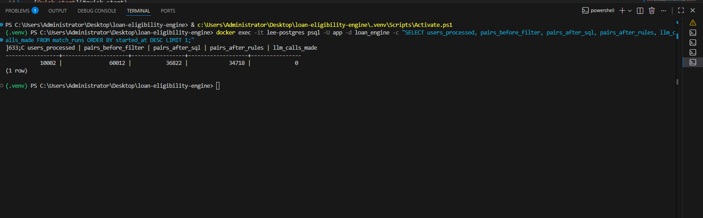
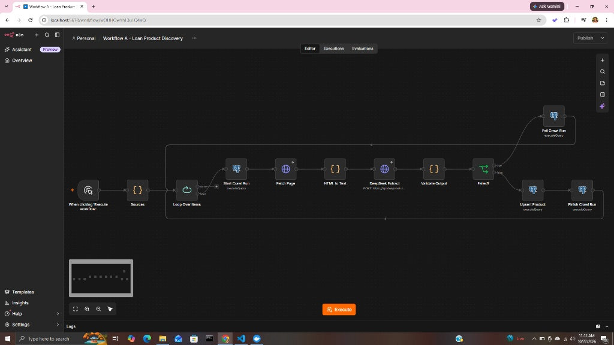
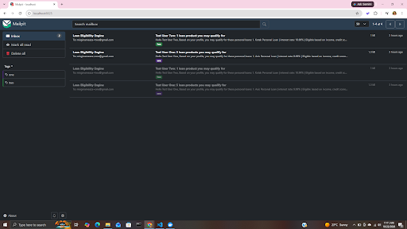

# The Loan Eligibility Engine

An automated pipeline that **ingests** user CSV data, **discovers** personal loan
products from public websites, **matches** users to eligible products with
deterministic SQL, and **notifies** them - orchestrated entirely through
self-hosted [n8n](https://n8n.io) workflows, backed by PostgreSQL.

> **One CSV in - eligibility out.** No black boxes: every decision is recorded,
> every funnel stage is measured, and eligibility requires **zero LLM calls**.

## Table of contents
- [Architecture](#architecture)
- [Live Pipeline in Action](#live-pipeline-in-action)
- [Quick start](#quick-start)
- [The pipeline](#the-pipeline)
- [Cost & Performance Optimization](#cost--performance-optimization)
- [Design decisions](#design-decisions)
- [Configuring credentials in n8n](#configuring-credentials-in-n8n)
- [Testing & CI](#testing--ci)
- [AWS deployment](#aws-deployment)
- [Project structure](#project-structure)

## Architecture

Full documentation with system diagrams: **[docs/architecture.md](docs/architecture.md)**.

```
CSV upload ─→ validate & upsert ─→ PostgreSQL ─→ Workflow B (matching) ─→ Workflow C (email)
                                     ↑                    │
              Workflow A (daily crawler: public lender product pages)
```

## Live Pipeline in Action

| 1. Borrower Ingestion UI (`:8000`) | 2. Matching Funnel Accounting |
|---|---|
|  |  |

| 3. n8n Automation Engine (`:5678`) | 4. Delivered Notifications (`:8025`) |
|---|---|
|  |  |

## Quick start

**Prerequisites:** Docker Desktop (WSL2 backend), Python 3.12, Git.

```powershell
git clone git@github.com:meazamisgina/loan-eligibility-engine.git
cd loan-eligibility-engine

# 1. Configure environment and dependencies
copy .env.example .env
py -m venv .venv
.venv\Scripts\python -m pip install -r ingest\requirements-dev.txt

# 2. Start the infrastructure (Postgres 16, self-hosted n8n, Mailpit)
docker compose up -d

# 3. Create the database schema
cmd /c "docker exec -i lee-postgres psql -U app -d loan_engine < infrastructure\sql\schema.sql"

# 4. (Optional) Load initial seed data
cmd /c "docker exec -i lee-postgres psql -U app -d loan_engine < infrastructure\sql\seed.sql"

# 5. Start the upload UI (http://localhost:8000)
.venv\Scripts\python -m uvicorn api.main:app --port 8000
```

Import the three workflows from `n8n/workflows/` into n8n (**http://localhost:5678** $\rightarrow$ Workflows $\rightarrow$ Import from file), configure credentials, and activate Workflows B and C.

**End-to-end flow:** Upload `data\users.csv` in the UI $\rightarrow$ rows are validated $\rightarrow$ matching executes automatically $\rightarrow$ check **http://localhost:8025** (Mailpit) to inspect the delivered notification emails.

## The pipeline

| Stage | Workflow | Trigger | What it does |
|---|---|---|---|
| **Ingest** | `ingest/` + API | CSV upload | Parse $\rightarrow$ validate $\rightarrow$ quarantine bad rows $\rightarrow$ idempotent upsert into `users` (one transaction per file, full audit in `ingestion_batches`) |
| **Discover** | **Workflow A** | Daily cron (02:00 UTC) | Crawl public lender product pages $\rightarrow$ LLM extraction with layered prompt-injection defense $\rightarrow$ upsert into `loan_products` (`crawl_runs` accounting) |
| **Match** | **Workflow B** | Webhook after ingest | SQL pre-filter (`eligible_pairs`) $\rightarrow$ rank by interest rate $\rightarrow$ cap 5 per user $\rightarrow$ `matches` with `reason_codes`; funnel measured in `match_runs` |
| **Notify** | **Workflow C** | Webhook after match | Deterministic templated email $\rightarrow$ AWS SES (production) or SMTP $\rightarrow$ Mailpit (demo); recorded in `notifications` |

## Cost & Performance Optimization

Filtering thousands of users against dozens of products via an LLM is slow and expensive. This system eliminates that cost. Measured on the **10,000-row dataset**:

| Stage | Mechanism | Pairs | LLM calls |
|---|---|---|---|
| 0 — naive | evaluate every user × product pair | **60,012** | 60,012 if done naively |
| 1 — SQL pre-filter | `eligible_pairs` view | **36,822** | 0 |
| 2 — n8n rules | rank by rate + cap 5/user | **34,718** | 0 |
| 3 — LLM | — | — | **0** |

Live numbers are in the `match_runs` table:

```sql
SELECT users_processed, pairs_before_filter, pairs_after_sql,
       pairs_after_rules, llm_calls_made
FROM match_runs ORDER BY started_at DESC LIMIT 1;
```

## Design decisions

Every design choice is documented as an Architecture Decision Record in [`docs/decisions/`](docs/decisions/):

| ADR | Title | Decision |
|---|---|---|
| [001](docs/decisions/ADR-001-upload-pattern.md) | Upload pattern | Event-driven upload (presigned URL $\rightarrow$ S3 $\rightarrow$ SQS $\rightarrow$ Lambda), not a synchronous API upload |
| [003](docs/decisions/ADR-003-matching-funnel.md) | Matching funnel | SQL-first matching; LLM excluded from eligibility (determinism + auditability) |
| [004](docs/decisions/ADR-004-crawl-targets.md) | Crawl targets | Crawl targets chosen by reconnaissance; product identity = config, not LLM output |
| [005](docs/decisions/ADR-005-match-semantics.md) | Match semantics | Hard pass/fail, no synthetic match scores; deterministic ranking + cap |
| [006](docs/decisions/ADR-006-email-template.md) | Email template | No LLM in customer communications (compliance risk reduction) |
| [007](docs/decisions/ADR-007-ui-scope.md) | UI scope | Single-page modern fintech interface backed by thin FastAPI adapter |
| [009](docs/decisions/ADR-009-local-first.md) | Local-first architecture | Local-first Docker demo + `serverless.yml` as validated IaC |
| [010](docs/decisions/ADR-010-email-transport.md) | Email transport | Transport split: AWS SES in production branch, Mailpit SMTP in local demo |
| [011](docs/decisions/ADR-011-secret-handling.md) | Secret handling | Secrets live only in `.env` / n8n credential store — never committed to Git |

## Configuring credentials in n8n

In n8n $\rightarrow$ **Credentials $\rightarrow$ Add credential**:

| Credential | Type | Values |
|---|---|---|
| `loan-db` | **PostgreSQL** | Host: `postgres` · Port `5432` · User `app` · Password: `POSTGRES_PASSWORD` · Database `loan_engine` |
| `deepseek-api` | **Header Auth** | Header `Authorization` · Value `Bearer <LLM_API_KEY>` (Workflow A extraction only) |
| `mailpit-smtp` | **SMTP** | Host `mailpit` · Port `1025` · no TLS, no auth (local demo) |
| `aws-ses` | **AWS SES** | Production only — created at deploy time; local runs route to SMTP (ADR-010) |

## Testing & CI

```powershell
scripts\check.bat
```

- **30 automated tests** covering row validation, CSV parsing, PostgreSQL quarantine and deduplication, and hostile API uploads.
- GitHub Actions CI validates linting, executes tests against real PostgreSQL services, and checks Docker Compose on every pull request.

## AWS deployment

`serverless.yml` defines the AWS deployment: S3 $\rightarrow$ SQS $\rightarrow$ Lambda (`ingest/handler.py`) $\rightarrow$ RDS, plus SES for notifications. Validate offline:

```powershell
npx serverless@3 print
```

## Project structure

```
├── api/                    # FastAPI upload endpoint (thin adapter over ingest)
├── frontend/               # Upload UI dashboard
├── ingest/                 # CSV pipeline: validation, persistence, handler
│   └── tests/              # Automated test suite (30 tests)
├── infrastructure/
│   └── sql/                # schema.sql, seed.sql
├── n8n/workflows/          # Workflow A/B/C JSON exports
├── docs/
│   ├── architecture.md     # System architecture diagrams
│   ├── screenshots/        # UI, workflow, and email proof images
│   └── decisions/          # ADR-001 through ADR-011
├── serverless.yml          # AWS IaC (S3/SQS/Lambda/SES)
├── docker-compose.yml      # Postgres + n8n + Mailpit stack
└── scripts/check.bat       # Pre-push validation script
```
