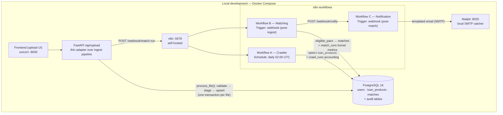
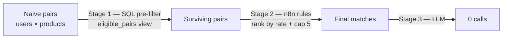

# Architecture

The Loan Eligibility Engine is an event-driven pipeline: **ingest** user CSV data,
**discover** loan products by crawling public sites, **match** users to products
with deterministic SQL, and **notify** them — all orchestrated through self-hosted
n8n workflows.

## System overview (local development)



## The matching funnel (the Optimization Treasure Hunt)

Eligibility is **deterministic**: a SQL pre-filter eliminates impossible pairs, n8n
applies business rules, and the LLM is never asked to judge eligibility.
Every stage is **measured** in `match_runs` — the numbers below come from the
pipeline's own accounting on the 10,000-user dataset, not from estimates.



| Stage | Mechanism | Pairs | LLM calls |
|---|---|---|---|
| 0 — naive | evaluate every user×product pair | 60,012 | 60,012 if done naively |
| 1 — SQL pre-filter | `eligible_pairs` view (income / credit / employment / age) | 36,822 | 0 |
| 2 — n8n rules | rank by interest rate, cap 5 per user | 34,718 | 0 |
| 3 — LLM | — | — | **0** |

> Re-run `SELECT * FROM match_runs ORDER BY started_at DESC LIMIT 1;` to see the
> live numbers. Two consecutive runs produce identical counts — matching is
> deterministic.

## Where the LLM is used (and where it is not)

| Concern | Mechanism | Why |
|---|---|---|
| Eligibility judgment | **SQL + deterministic rules, zero LLM** | Lending decisions must be explainable and auditable; a model cannot justify a rejection |
| Web-page extraction (Workflow A) | LLM (DeepSeek), **layered defense** | Messy HTML → structured criteria is an extraction task, not a decision |
| Customer emails (Workflow C) | **Deterministic template, no LLM** | A hallucinated rate in customer comms is legal liability (ADR-006) |

Prompt-injection defense for extraction, layered: scraped text is framed as
untrusted data → system prompt forbids following in-page instructions →
temperature 0 → JSON schema validation → enum clamping → escaped SQL →
DB `CHECK` constraints as the final gate.

## Data model

```
ingestion_batches ─┬─< users_staging    (raw rows, reprocessable)
                   ├─< users_rejected   (quarantine + reason)
                   └─< users            (canonical, CHECK-enforced)
crawl_runs ────────< loan_products      (upsert on (source_url, product_name))
match_runs ──┬────< matches >─── users, loan_products   (reason_codes per match)
             └────< notifications                         (email audit trail)
```

Full DDL: [`infrastructure/sql/schema.sql`](../infrastructure/sql/schema.sql).
Decision records: [`docs/decisions/`](decisions/).

## AWS deployment (serverless.yml)

The local stack maps 1:1 to AWS — same code, managed services:

| Local | AWS | Notes |
|---|---|---|
| API/drop-folder upload | **S3** uploads bucket | private, AES-256, HTTPS-only, 30-day lifecycle |
| (file event) | **SQS → Lambda** | `ingest/handler.lambda_handler` — the same tested handler |
| Postgres container | **RDS** PostgreSQL | Lambda in private subnets |
| Mailpit (SMTP) | **SES** | Workflow C's SES node branch |

Validated offline with `serverless print`; live deploy is optional (the assignment
explicitly accepts local deployment). Details: [`serverless.yml`](../serverless.yml)
and [ADR-009](decisions/ADR-009-local-first.md).

## Failure isolation

- **Ingest:** one transaction per file — batch accounting can never disagree with
  the rows; bad rows are quarantined with reasons, never silently dropped; bad
  files fail the batch without partial writes.
- **Crawler:** each source is an isolated iteration with its own `crawl_runs`
  record; one broken page cannot kill the run; `products_found = 0` detects
  silent layout changes.
- **Matching:** a zero-match run completes gracefully; counters are DB-truth.
- **Notification:** the webhook trigger is best-effort; an unreachable mail
  transport never corrupts the matches.
- **Tests:** integration assertions are scoped on both sides of every join
  (test-owned users *and* products) — committed data can never leak into results.